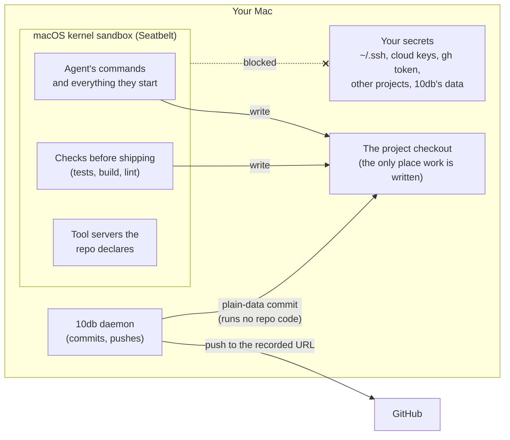

# How 10db keeps agents contained

10db runs several AI coding agents at once on your Mac, unattended, each working on a real repository.
That only works if a confused or manipulated agent can't hurt anything outside the work it was given.
This page explains how 10db makes sure of that, how we check it, and what it doesn't cover.

For the full engineering detail, every rule and how it is enforced, see the threat model:
[docs/architecture/03-trust-boundaries.md](architecture/03-trust-boundaries.md).

## The problem

An agent ("lane", in 10db) reads a lot of text it didn't write: the repository, dependency source, issues,
web pages, test output, other agents' notes. Any of that can contain instructions. So 10db assumes the worst:
**any lane might be steered by something it read, and will then use every tool it has like an attacker would.**

Meanwhile it is running on your machine, next to your SSH keys, cloud credentials, GitHub login, other
projects and 10db's own controls. And unlike an assistant you watch, nobody approves each step.

So the rule is simple: **nothing an agent can influence ever runs outside a sandbox, and nothing in a
sandbox can reach what it doesn't need.** Approvals and warnings in the inbox are a convenience on top, never
the thing holding the line.

## The three walls

### 1. The agent runs in a sandbox

Every command an agent runs, and everything that command starts, runs inside macOS's kernel sandbox
(Seatbelt, the same engine Claude Code uses). The sandbox is always on; there is no switch to forget.

Inside it, an agent:

- **reads** only what the work needs: its project checkout and the toolchains it builds with (node,
  cargo, git and so on, opened file by file, never their config folders). Your home folder, `~/.ssh`,
  keychains, cloud configs and other projects are simply not there.
- **writes** only its checkout and its own temporary folder. Package caches are per agent and deleted
  afterwards, so one agent can't plant code that another later runs.
- **sees no credentials.** Its environment is rebuilt from an allowlist: no GitHub token, no SSH agent,
  no cloud keys.
- **reaches only the project's allowed hosts.** Every other connection goes to a proxy that refuses it.
- **can't touch git's internals.** `.git` is read-only to every agent, for every project, so it can't move
  branches, plant hooks or rewrite history. Agents can't push at all.

The agent's file tools (read, edit, search) run inside Claude Code itself, so 10db checks every path they
touch the same way: real paths only, links resolved, secrets refused.

### 2. The checks run in a sandbox too

Before work ships, 10db runs the project's checks: tests, build, lint. Those are code the agent may have
written, so they run in the same kind of sandbox, through
[`@anthropic-ai/sandbox-runtime`](https://github.com/anthropics/sandbox-runtime): the same reads,
their own temporary folder, no credentials, no Docker, and only the project's network. A test that tries to
read your SSH key finds nothing there. A check that is killed or crashes counts as a failure, never a pass.

The same applies to tool servers ("MCP servers") a repository declares and you approve: each runs in its
own sandbox, with nothing but the values you approved, and it reaches only the internet hosts its approval
names (in the repository's `.10db/mcp-hosts.json`, shown on the approval card), or none.

### 3. 10db's own git can't be tricked

10db itself commits and pushes the work, outside any sandbox, so it must never run anything the repository
controls. Git normally runs plenty of repository code: hooks, filters, file-type drivers, file monitors,
submodules. 10db switches every one of those off on every call and commits files as plain data. It commits
only on the branch recorded for the work, only in the checkout recorded for the project, and pushes only to
the URL recorded for it. If anything about the checkout changed underneath it, it stops and asks you instead.

## What an agent can and can't do

| An agent can                                | An agent can't                                                   |
| ------------------------------------------- | ---------------------------------------------------------------- |
| Read and change its own project's files     | Read your home folder, `~/.ssh`, keychains or cloud config       |
| Run builds and tests                        | Get your GitHub token, SSH agent or cloud keys                   |
| Use the project's toolchains                | Write outside its checkout and temporary folder                  |
| Reach the hosts you allowed for the project | Reach any other host                                             |
| Ask you for something in the inbox          | Change git history, branches or hooks, or push                   |
|                                             | Touch another project, another agent's files, or 10db's own data |
|                                             | Make the checks pass by crashing or being killed                 |

Worktree mode, where each task works in its own git worktree, adds no process outside the sandbox: the daemon's worktree git calls run under the same config as its other git calls, and the seed copy of ignored directories runs nothing.

## How we check it

- **A live test against the real Claude Code.** It starts real agent sessions and has them try to break out:
  read planted secret "canaries", write to `.git`, hard-link around the rules, reach blocked hosts, find
  tokens, call a sandboxed tool server. Every attempt must fail while normal work still succeeds. It runs
  after every Claude Code upgrade.
- **Sandbox tests on every pull request.** The checks sandbox and the tool-server sandbox have their own
  tests against the real macOS sandbox, run in CI on macOS for every change.
- **Independent adversarial review.** Every security change is reviewed by a separate reviewer whose job is
  to break it, and every hole found becomes a test that fails first.
- **Proven on itself.** 10db's own full set of checks passes inside the sandbox.

## What it doesn't cover

Being honest about the edges is part of the design:

- **Not a virtual machine.** The sandbox is the macOS kernel's own, shared with the rest of your Mac. A bug in
  macOS's sandbox would matter; a VM or a cloud container wouldn't have that exposure.
- **Allowed hosts are allowed both ways.** If a project lets agents reach a host, an agent could send data
  there too. Keep the list short.
- **The agent can use its own account.** A steered agent can spend the Claude usage its project is given.
- **Some tools can't run sandboxed yet.** Repositories that use Git LFS can't ship through 10db; pnpm 12 can't
  install packages inside an agent (you get a card to run it yourself); browser end-to-end tests are skipped
  inside the sandbox and run in CI instead; checks that need Docker fail with a clear reason.
- **One macOS user.** 10db, the agents and you share a user account, so anything already running as you
  (malware, say) is out of scope.
- **Merged code is yours to review.** Once you merge an agent's pull request, its code runs wherever your
  code runs. Review and CI before merge are that boundary.
- **New and unaudited.** This is young software built by one person with AI help, without an outside audit.

## Reporting a problem

If you find a way out, please report it privately as described in [SECURITY.md](../SECURITY.md).
